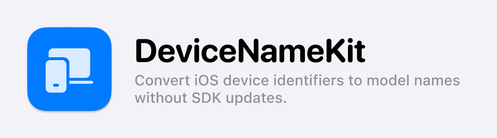

> You can view the document in different languages: [English](README.md), [한국어](README_ko.md), [日本語](README_jp.md)

**DeviceNameKit**은 Apple 기기의 **기기 식별자(Device Identifier)를 상업용 모델명(Device Model Name)으로 변환**하는 SDK입니다. iPhone, iPad, Mac, Apple Watch, Apple TV, Vision Pro 등 모든 Apple 플랫폼을 지원합니다.

이 라이브러리는 Apple 내부 기기 식별자(예: `iPhone15,2`)를 사용자가 이해하기 쉬운 제품명(예: `iPhone 14 Pro`)으로 변환합니다. 매핑 데이터는 SDK에 번들되어 있어 **대부분의 기기는 네트워크 요청 없이 즉시 변환**되며, 번들 데이터에 없는 신규 기기만 원격 데이터를 조회하므로 **앱 업데이트 없이도 새 기기에 대응**할 수 있습니다.

- **로컬 우선(Local-first) 변환**: 번들된 데이터로 오프라인에서도 즉시 동작
- **신규 기기 자동 대응**: 번들에 없는 기기만 원격 데이터를 조회하여 앱 업데이트 없이 대응
- **한 번 해석되면 영구 저장**: 성공한 결과만 기기에 저장하고, 이후에는 네트워크 요청이 발생하지 않음
- **비동기(async/await) 지원**: Swift Concurrency 기반의 직관적인 비동기 처리
- **Completion Handler 지원**: 기존 콜백 패턴도 그대로 사용 가능
- **Combine API 지원**: 구독 시점에 실행되는 반응형 데이터 흐름 제공
- **안전한 조회**: `getSafeDeviceName()`은 실패 시에도 기기 식별자를 반환하여 앱 동작을 유지

기기 모델명이 필요한 다양한 상황, 예를 들어 **디바이스별 설정 적용, 로그 분석, A/B 테스트, CS 문의 대응** 등에 활용할 수 있습니다.

Demo 앱은 [여기](https://github.com/kimdaehee0824/DeviceNameKit_Demo)에서 확인할 수 있습니다.

## 2.0의 변경 사항

v2.0.0은 데이터 조회 구조를 로컬 우선 방식으로 전면 개편했습니다. **공개 API는 그대로이므로 코드 수정 없이 업데이트할 수 있습니다.**

- 기기 데이터가 SDK에 번들되어, 오프라인·네트워크 차단 환경에서도 동작합니다.
- 원격 조회는 번들 데이터에 없는 신규 기기에서만 수행됩니다.
- 해석에 성공한 이름만 저장됩니다. 매핑이 아직 없는 기기 식별자는 저장되지 않고, 데이터가 갱신되면 자동으로 다시 시도합니다.
- 1.x가 저장한 캐시는 자동으로 이전되며, 식별자가 그대로 저장된 잘못된 캐시는 폐기 후 재해석합니다.
- 기본 캐시 정책이 `.noCache`에서 `.forever`로 변경되었습니다. 기기 모델명은 변하지 않으므로 영구 저장이 기본값으로 적합합니다.
- 시뮬레이터에서는 호스트 아키텍처(`arm64`) 대신 시뮬레이트 중인 기기의 모델명을 반환합니다.

## 지원 플랫폼

| OS       | 최소 지원 버전 |
| -------- | -------- |
| iOS      | 13.0+    |
| macOS    | 11.0+    |
| watchOS  | 6.0+     |
| tvOS     | 13.0+    |
| visionOS | 1.0+     |

## 설치 방법

### Swift Package Manager (SPM)

1. Xcode에서 `File > Add Packages...` 를 선택합니다.
2. 다음 URL을 입력하여 패키지를 추가합니다.
   ```
   https://github.com/kimdaehee0824/DeviceNameKit.git
   ```
3. 버전은 `2.0.0` 이상을 선택한 뒤, `import DeviceNameKit` 으로 사용합니다.

## 사용법

### 1. 기본적인 기기 모델명 변환 (`async/await`)
```swift
let fetcher = DeviceNameFetcher() // 기본 정책: .forever

Task {
    do {
        let modelName = try await fetcher.getDeviceName()
        print("기기 모델명: \(modelName)") // 예: iPhone 14 Pro
    } catch {
        print("오류 발생: \(error.localizedDescription)")
    }
}
```

### 2. Completion Handler 방식 사용
```swift
let fetcher = DeviceNameFetcher()

fetcher.getDeviceName { result in
    switch result {
    case .success(let modelName):
        print("기기 모델명: \(modelName)")
    case .failure(let error):
        print("오류 발생: \(error.localizedDescription)")
    }
}
```

### 3. Combine API 사용
```swift
import Combine

let fetcher = DeviceNameFetcher()

let cancellable = fetcher.getDeviceNamePublisher()
    .sink(receiveCompletion: { completion in
        if case .failure(let error) = completion {
            print("오류 발생: \(error)")
        }
    }, receiveValue: { modelName in
        print("기기 모델명: \(modelName)")
    })
```

### 4. 오류를 방출하지 않는 함수 (`getSafeDeviceName`)
`getSafeDeviceName()`은 해석에 실패하더라도 기기 식별자를 반환하므로, 별도의 에러 핸들링이 필요 없을 때 사용하면 좋습니다.

```swift
let fetcher = DeviceNameFetcher()

Task {
    let modelName = await fetcher.getSafeDeviceName()
    print("기기 모델명: \(modelName)")
}
```
이 메서드는 실패 시 원래의 기기 식별자를 반환하고, `os.log`로 실패 로그를 기록합니다.

### 5. `preload()`를 활용한 사전 로드
`preload()`를 호출하면 백그라운드에서 미리 모델명을 해석해 둡니다. 앱 시작 시 호출해 두면 실제 사용 시점에는 이미 값이 준비되어 있습니다.

```swift
let fetcher = DeviceNameFetcher()
fetcher.preload() // 앱 시작 시 미리 해석
```

### 6. `deviceModel` 속성으로 동기 접근
저장된 값 또는 번들 데이터에서 모델명을 네트워크 없이 바로 가져옵니다. 번들 데이터에 없는 신규 기기가 아직 원격으로 해석되지 않은 경우에만 `nil`을 반환합니다.

```swift
print("현재 기기 모델명: \(fetcher.deviceModel ?? "알 수 없음")")
```

## 캐시 정책

캐시 정책은 **해석에 성공한 모델명을 기기에 얼마나 오래 저장할지**를 결정합니다. 해석에 실패한 식별자는 정책과 무관하게 절대 저장되지 않습니다.

| 정책 | 설명 |
|---|---|
| `.forever` (기본값) | 한 번 해석된 이름을 영구 저장 — 권장 |
| `.oneDay` | 1일간 저장 |
| `.threeDays` | 3일간 저장 |
| `.sevenDays` | 7일간 저장 |
| `.oneMonth` | 1개월간 저장 |
| `.custom(TimeInterval)` | 사용자 지정 기간 |
| `.noCache` | 저장하지 않고 매번 다시 해석 (번들 데이터는 항상 우선 사용) |

기기 모델명은 기기가 바뀌지 않는 한 변하지 않으므로, 기본값인 `.forever`를 그대로 사용하는 것을 권장합니다.

```swift
let fetcher = DeviceNameFetcher(cachePolicy: .forever)
```

## 에러 처리
`DeviceNameFetcherError` 열거형을 통해 발생한 에러를 확인할 수 있습니다.

```swift
public enum DeviceNameFetcherError: Error {
    case fetchFailed(deviceIdentifier: String, underlyingError: Error)
}
```
에러가 발생한 경우 `deviceIdentifier`(예: `"iPhone15,2"`)와 원인이 된 `underlyingError`를 확인할 수 있습니다. 이 에러는 로컬 데이터에 없는 기기의 원격 조회가 실패했을 때만 발생합니다.

## 동작 원리
1. **기기 식별자 조회**: `uname()` 또는 `sysctlbyname("hw.model")`로 현재 기기의 식별자를 가져옵니다.
2. **저장된 값 확인**: 이전에 해석에 성공한 이름이 기기에 저장되어 있으면 즉시 반환합니다.
3. **번들 데이터 조회**: SDK에 포함된 JSON 데이터에서 식별자를 찾습니다. 대부분의 기기는 여기서 해석이 끝나며, 네트워크 요청이 발생하지 않습니다.
4. **원격 데이터 조회**: 번들 데이터에 없는 신규 기기인 경우에만 이 저장소의 `DeviceName` 폴더에 있는 최신 JSON을 조회합니다. 원격 데이터에도 아직 없다면 식별자를 그대로 반환하고, 일정 시간(1시간) 후 다시 시도합니다.

해석에 성공한 이름만 저장되므로, 데이터 공백기에 잘못된 값이 영구 저장되는 일은 발생하지 않습니다.

## 1.x에서 업그레이드

코드 수정 없이 버전만 올리면 됩니다. 다음 동작 변화만 참고하세요.

- 기본 캐시 정책이 `.forever`로 변경되었습니다. 이전 기본값(`.noCache`)을 유지하려면 `DeviceNameFetcher(cachePolicy: .noCache)`로 명시하세요.
- 1.x가 저장한 캐시는 첫 실행 시 자동으로 이전됩니다. 매핑 공백기에 식별자가 그대로 저장된 캐시는 폐기되고 올바른 이름으로 다시 해석됩니다.
- 1.x 사용자를 위해 이 저장소의 `DeviceName/` 폴더와 JSON 스키마는 그대로 유지됩니다.

## 기여 방법

1. 이슈 또는 기능 요청은 `Issues` 탭에 남겨주세요.
2. PR은 언제나 환영합니다. 검토 후 다음 버전에 반영하겠습니다.
3. 기기 데이터는 `DeviceName/` 폴더의 JSON 하나로 관리됩니다. 패키지가 이 폴더를 직접 번들하므로 별도의 동기화 작업은 필요 없습니다.

> [!NOTE]
> 이 저장소의 업데이트가 느리거나 JSON을 직접 관리하고 싶다면, 저장소를 fork하여 사용하세요. `Constant.swift`의 `modelNamePath`를 fork한 저장소 주소로 변경하면 됩니다.

## 라이선스

이 프로젝트는 MIT 라이선스 하에 배포됩니다. 자세한 내용은 [`LICENSE`](LICENSE) 파일을 참고하세요.
